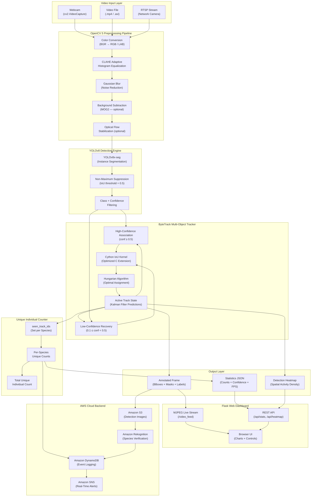
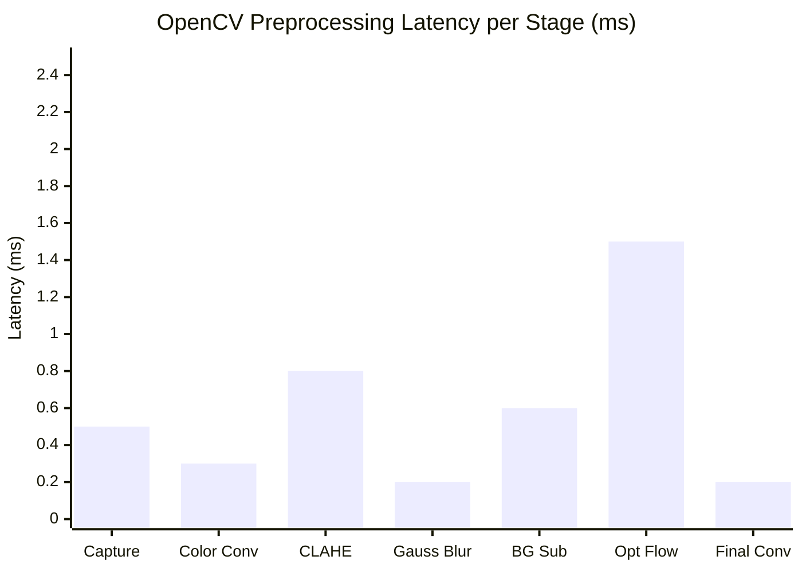
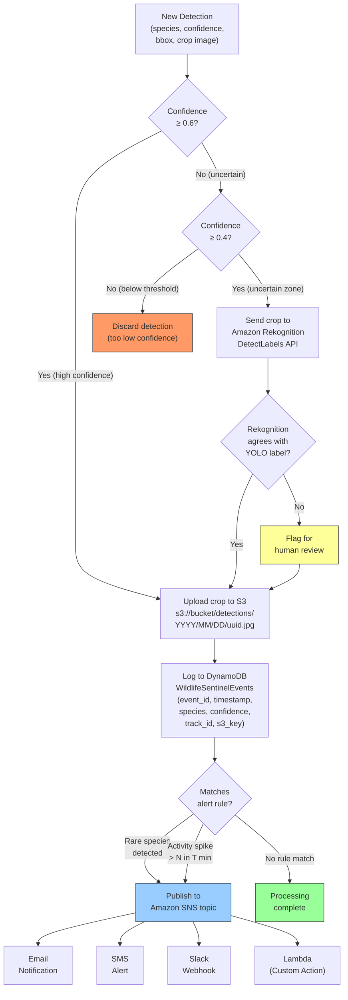
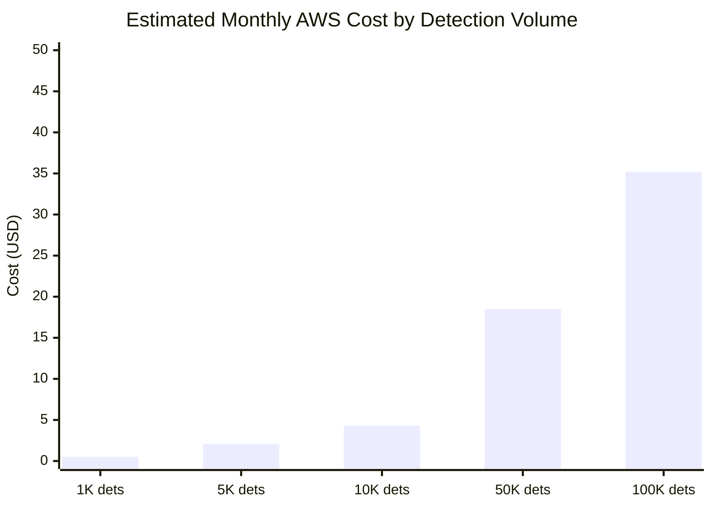
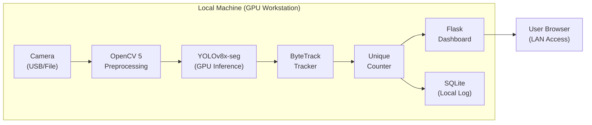
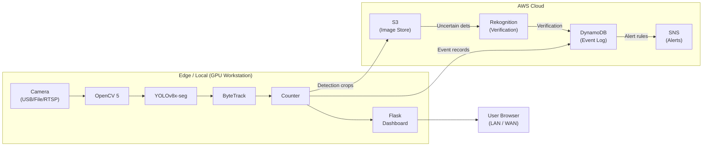
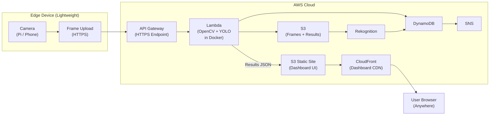
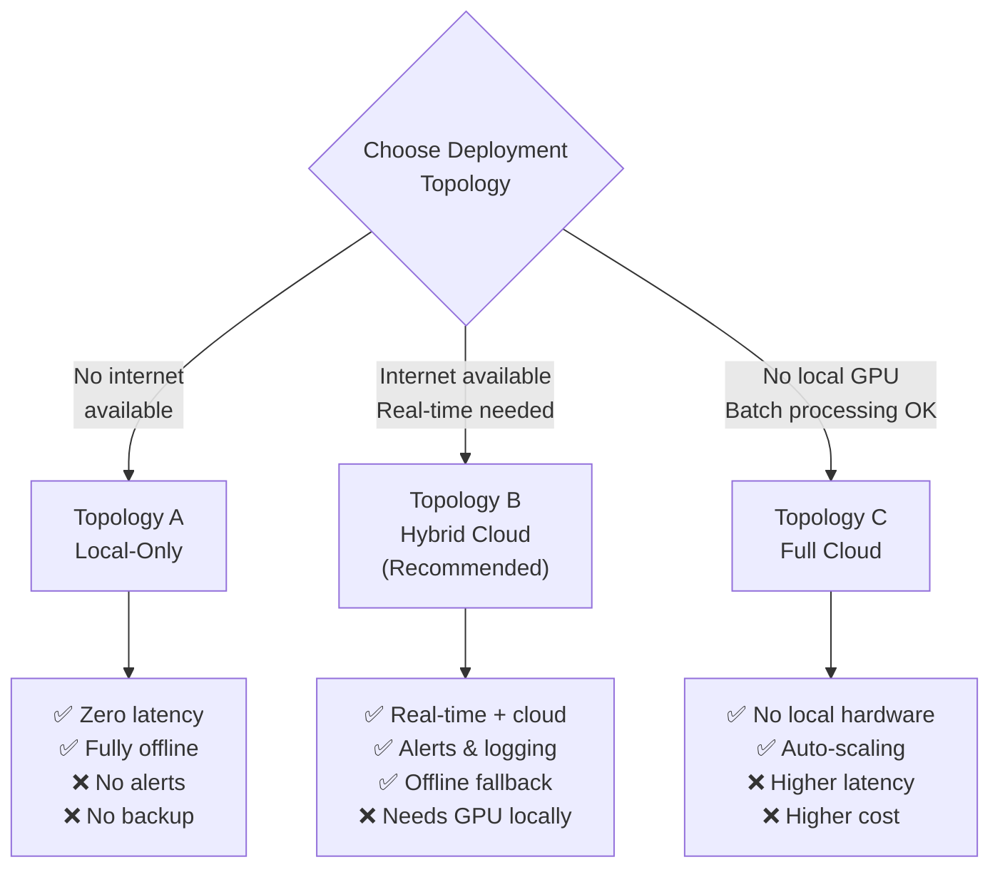
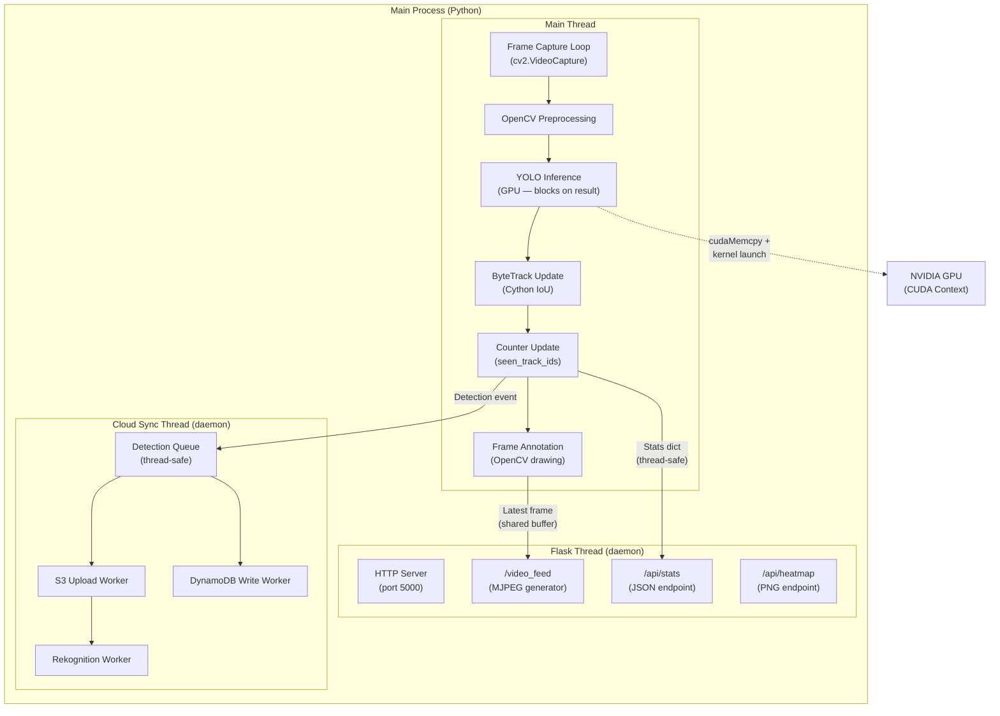

# Wildlife Sentinel — Architecture Document

> Companion document to the [Technical Report](./TECHNICAL_REPORT.md).
> This document provides visual architectural diagrams using Mermaid,
> covering the full system from video ingestion to cloud backend.

---

## 1. System Components and Data Flow

The following diagram shows the complete Wildlife Sentinel system, from video
source ingestion through detection, tracking, counting, and output delivery to
both the web dashboard and AWS cloud backend.



---

## 2. OpenCV Processing Pipeline Stages

This diagram details the sequential OpenCV operations applied to each incoming
frame before it reaches the YOLO detection engine. Each stage is annotated with
the specific OpenCV API calls used.

```mermaid
flowchart LR
    subgraph Capture["Stage 1: Capture"]
        CAP["cv2.VideoCapture.read()\nRaw BGR frame\n1280×720×3"]
    end

    subgraph ColorConv["Stage 2: Color"]
        BGR2LAB["cv2.cvtColor()\nBGR → LAB\nfor CLAHE"]
        SPLIT["cv2.split()\nExtract L channel"]
    end

    subgraph Enhance["Stage 3: Enhance"]
        CLAHE_OP["cv2.createCLAHE()\nclipLimit=2.0\ntileGrid=8×8"]
        MERGE["cv2.merge()\nRecombine LAB"]
        LAB2BGR["cv2.cvtColor()\nLAB → BGR"]
    end

    subgraph Denoise["Stage 4: Denoise"]
        GAUSS["cv2.GaussianBlur()\nkernel=5×5, σ=0"]
    end

    subgraph MotionDet["Stage 5: Motion (Optional)"]
        MOG2["cv2.createBackground\nSubtractorMOG2()"]
        FG["Foreground mask\n(skip frame if empty)"]
    end

    subgraph Stabilize["Stage 6: Stabilize (Optional)"]
        GFTT["cv2.goodFeaturesToTrack()"]
        LK["cv2.calcOpticalFlowPyrLK()"]
        WARP["cv2.warpAffine()\n(Compensate camera shake)"]
    end

    subgraph Convert["Stage 7: Final Convert"]
        BGR2RGB["cv2.cvtColor()\nBGR → RGB\n(for YOLO input)"]
    end

    CAP --> BGR2LAB
    BGR2LAB --> SPLIT
    SPLIT --> CLAHE_OP
    CLAHE_OP --> MERGE
    MERGE --> LAB2BGR
    LAB2BGR --> GAUSS
    GAUSS --> MOG2
    MOG2 --> FG
    FG --> GFTT
    GFTT --> LK
    LK --> WARP
    WARP --> BGR2RGB
```



### Pipeline Timing Breakdown



---

## 3. AWS Cloud Integration Flow

This diagram illustrates the data flow between Wildlife Sentinel's local
processing engine and the AWS cloud backend services. It shows decision points,
async operations, and the alert pipeline.



### Cloud Cost Estimation



> **Cost drivers**: S3 storage ($0.023/GB), Rekognition DetectLabels ($0.001/image,
> only uncertain detections), DynamoDB on-demand ($1.25/M writes), SNS ($0.50/100K
> notifications). Costs assume ~10% of detections are in the uncertain zone.

---

## 4. Deployment Topology Options

Wildlife Sentinel supports three deployment topologies, from fully local to
fully cloud-managed. The following diagrams illustrate each option.

### 4.1 Topology A — Local-Only Deployment

All processing runs on a single machine. No cloud dependencies. Suitable for
field stations with limited or no internet connectivity.



**Characteristics:**
| Property | Value |
|---|---|
| Internet required | No |
| Data persistence | Local SQLite + filesystem |
| Alerting | None (or local email via SMTP) |
| Scalability | Single camera, single machine |
| Setup complexity | Low |

### 4.2 Topology B — Hybrid Cloud Deployment (Recommended)

Local GPU handles real-time inference; AWS provides persistent storage, secondary
verification, and alerting. The recommended deployment for connected field
stations.



**Characteristics:**
| Property | Value |
|---|---|
| Internet required | Yes (for cloud sync; degrades gracefully if offline) |
| Data persistence | S3 + DynamoDB (durable, queryable) |
| Alerting | SNS (email, SMS, Slack) |
| Scalability | Multiple cameras on one GPU, cloud scales independently |
| Setup complexity | Medium |

### 4.3 Topology C — Full Cloud / Serverless Deployment

All processing runs on AWS. Video frames are uploaded from lightweight edge
devices (Raspberry Pi, phone) and processed by Lambda functions. Suitable for
batch processing or mobile-uploaded images.



**Characteristics:**
| Property | Value |
|---|---|
| Internet required | Yes (always) |
| Data persistence | S3 + DynamoDB |
| Alerting | SNS (email, SMS, Slack) |
| Scalability | Auto-scaling via Lambda concurrency |
| Setup complexity | High (Docker images, IAM, API Gateway) |
| Real-time processing | No (batch / near-real-time, ~2–5 sec latency per image) |
| GPU | Not available in Lambda; uses CPU YOLO or Rekognition only |

---

## 5. Deployment Topology Comparison



---

## 6. Data Model

```mermaid
erDiagram
    CAMERA {
        string camera_id PK
        string location
        string stream_url
        string status
    }

    DETECTION_EVENT {
        string event_id PK
        string timestamp SK
        string species
        float confidence
        int track_id
        string bbox_json
        string s3_key
        string camera_id FK
        boolean is_verified
    }

    TRACK {
        int track_id PK
        string species
        string first_seen
        string last_seen
        int frame_count
        string appearance_descriptor
    }

    ALERT_RULE {
        string rule_id PK
        string species_filter
        float confidence_threshold
        int spike_count
        int spike_window_sec
        string sns_topic_arn
    }

    CAMERA ||--o{ DETECTION_EVENT : "produces"
    DETECTION_EVENT }o--|| TRACK : "belongs to"
    ALERT_RULE ||--o{ DETECTION_EVENT : "triggers on"
```

---

## 7. Thread and Process Architecture



---

*Wildlife Sentinel — Architecture Document*
*Last updated: October 2026*
